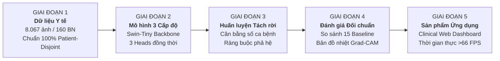

# BÁO CÁO TÓM TẮT ĐỀ TÀI NGHIÊN CỨU KHOA HỌC KỸ THUẬT

**CUỘC THI KHOA HỌC KỸ THUẬT DÀNH CHO HỌC SINH TRUNG HỌC (ViSEF)**  
**Lĩnh vực dự thi:** Hệ thống nhúng và Phần mềm hệ thống  
**Phân ngành:** Trí tuệ nhân tạo & Y sinh học  

---

# TÊN ĐỀ TÀI:
## HỆ THỐNG TRÍ TUỆ NHÂN TẠO HỌC PHÂN CẤP ĐA TẦNG HỖ TRỢ CHẨN ĐOÁN HÌNH ẢNH NỘI SOI BÀNG QUANG THỜI GIAN THỰC

---

## TÓM TẮT ĐỀ TÀI (ABSTRACT)

Nội soi bàng quang (*Cystoscopy*) là phương pháp tiêu chuẩn vàng trong tầm soát, chẩn đoán và theo dõi ung thư bàng quang. Tuy nhiên, các bác sĩ thường đối mặt với nguy cơ bỏ sót các tổn thương nguy hiểm nhưng khó thấy (như ung thư biểu mô tại chỗ *CIS* có bề mặt phẳng giống niêm mạc viêm) và hiện tượng mệt mỏi thị giác khi thực hiện nhiều ca nội soi liên tục. 

Đề tài nghiên cứu và phát triển **CystoHier** — một hệ thống Trí tuệ nhân tạo (AI) hỗ trợ chẩn đoán hình ảnh nội soi bàng quang theo thời gian thực với **điểm mới đột phá**: **Xử lý đồng thời và nhất quán cả 3 cấp độ chẩn đoán y khoa trong một mô hình duy nhất**:
1. **Cấp 1 (Nhị phân):** Phát hiện tức thời có tổn thương nghi ngờ (*ROI*) hay không (*Non-ROI*).
2. **Cấp 2 (Nhóm bệnh cảnh thô - 5 nhóm):** Phân loại tổn thương thành Ác tính, Không ác tính, Niêm mạc bình thường, Mốc giải phẫu, hoặc Dị vật.
3. **Cấp 3 (Bệnh học chi tiết - 22 phân lớp):** Định danh chính xác tên bệnh lý cụ thể (như Ung thư nhú độ cao, Ung thư tại chỗ CIS, U nhú niệu mạc...).

Được đánh giá nghiêm ngặt theo giao thức **100% độc lập bệnh nhân (*Patient-Disjoint*)** trên 8.067 ảnh từ 160 bệnh nhân, mô hình đạt kết quả vượt bậc:
- **Độ nhạy phát hiện tổn thương:** **98,45%** (Binary AUROC đạt **0,9986**), gần như triệt tiêu nguy cơ bỏ sót bệnh.
- **Độ chính xác nhóm bệnh:** **86,42%**.
- **Nhận diện phân lớp hiếm (Fine F1-Score):** **0,6450** (vượt trội so với các mạng CNN truyền thống chỉ đạt ~0,35).
- **Tính nhất quán chẩn đoán giữa các tầng:** Đạt **89,52%** (loại bỏ hoàn toàn mâu thuẫn logic giữa tầng cha và tầng con).
- **Minh bạch thị giác:** Bản đồ nhiệt Grad-CAM định vị chính xác vùng giải phẫu tổn thương cao gấp **4,71 lần** mô hình thông thường.

Dự án đã hiện thực hóa thành phần mềm **Clinical Web Dashboard** hoàn chỉnh, đạt tốc độ xử lý **66,7 – 82,8 khung hình/giây (FPS)** với độ trễ chỉ 15 ms trên máy tính thông thường, sẵn sàng kết nối hỗ trợ bác sĩ trực tiếp trong phòng mổ.

---

# PHẦN 1: ĐẶT VẤN ĐỀ & MỤC TIÊU ĐỀ TÀI

### 1.1. Bối cảnh thực tế và Lý do chọn đề tài
- **Mức độ phổ biến và nguy hiểm:** Ung thư bàng quang là một trong những bệnh ung thư đường tiết niệu phổ biến nhất thế giới. Tỷ lệ tái phát sau phẫu thuật lên đến 50% – 70%, đòi hỏi người bệnh phải nội soi định kỳ suốt đời.
- **Thách thức của bác sĩ nội soi:**
  - *Tổn thương phẳng dễ bị bỏ sót:* Khác với ung thư dạng chồi súp-lơ dễ nhìn thấy, ung thư biểu mô tại chỗ (*Carcinoma in situ - CIS*) là tổn thương phẳng, chỉ hơi đỏ nhẹ giống niêm mạc viêm thông thường nên tỷ lệ bỏ sót bằng mắt thường có thể lên tới 20% – 30%.
  - *Mệt mỏi thị giác:* Bác sĩ phải quan sát liên tục trong môi trường nội soi có góc nhìn hẹp, nước rửa dịch chuyển, bọt khí và phản xạ ánh sáng.

### 1.2. Khoảng trống công nghệ của các giải pháp AI hiện nay
Hầu hết các nghiên cứu AI nội soi hiện nay chỉ dừng lại ở bài toán phân loại phẳng đơn giản (chỉ đoán có u hay không u) hoặc tách làm nhiều mô hình riêng rẽ, dẫn đến **mâu thuẫn logic chẩn đoán**: Có trường hợp AI đoán chi tiết là "Ung thư nhú", nhưng ở tầng nhóm lớn lại bảo là "Lành tính". Ngoài ra, dữ liệu thực tế bị mất cân bằng trầm trọng (niêm mạc bình thường chiếm gần 80% số ảnh, trong khi ca ung thư hiếm chỉ xuất hiện ở 2-3 bệnh nhân).

### 1.3. Mục tiêu của đề tài
1. Xây dựng mô hình AI có khả năng **xử lý đồng thời cả 3 cấp độ chẩn đoán y khoa** một cách chính xác và nhất quán.
2. Xây dựng **phần mềm hỗ trợ lâm sàng thời gian thực** có giao diện trực quan, bản đồ nhiệt giải thích vùng tổn thương cho bác sĩ và tốc độ đạt trên 60 FPS.

---

# PHẦN 2: QUY TRÌNH NGHIÊN CỨU (STANDARD PIPELINE)

Đề tài được thực hiện theo quy trình chuẩn mực gồm 5 giai đoạn nối tiếp:



---

### GIAI ĐOẠN 1: THU THẬP & CHUẨN HÓA DỮ LIỆU
1. **Dữ liệu nghiên cứu:** 8.067 ảnh nội soi từ 160 bệnh nhân (gồm cả ảnh ánh sáng trắng WLC và ảnh dải tần hẹp NBI) được dán nhãn bởi các chuyên gia niệu khoa.
2. **Tiền xử lý ảnh:**
   - Tự động cắt bỏ viền đen tròn của ống soi (*Center Crop*), giữ lại 100% trường nhìn hữu ích.
   - Chuẩn hóa kích thước ảnh về $224 \times 224$ pixel.
3. **Giao thức phân chia dữ liệu độc lập bệnh nhân (100% Patient-Disjoint):**
   - Tuyệt đối không chia ngẫu nhiên theo ảnh để tránh rò rỉ dữ liệu.
   - Toàn bộ ảnh của cùng 1 bệnh nhân chỉ nằm duy nhất trong 1 tập: **70% Bệnh nhân để huấn luyện (Train)**, **15% Bệnh nhân để hiệu chỉnh (Validation)**, và **15% Bệnh nhân để thi kiểm tra độc lập (Test)**.

---

### GIAI ĐOẠN 2: ĐIỂM MỚI CỐT LÕI CỦA MÔ HÌNH (PROPOSED METHOD)

Điểm mới sáng tạo và khác biệt lớn nhất của nghiên cứu nằm ở việc **tích hợp trọn vẹn tư duy chẩn đoán 3 cấp độ của bác sĩ vào trong 1 kiến trúc mạng duy nhất**:

```text
               Ảnh nội soi bàng quang đầu vào (224x224)
                                │
                                ▼
               Mạng trích xuất đặc trưng Swin-Tiny
        (Học quan hệ không gian toàn cục của lòng bàng quang)
                                │
        ┌───────────────────────┼───────────────────────┐
        ▼                       ▼                       ▼
   CẤP 1: NHỊ PHÂN        CẤP 2: NHÓM BỆNH        CẤP 3: CHI TIẾT
   (Binary Head)          (Coarse Head)           (Fine Head)
     - Non-ROI              - Malignant             - LowGradePapillary
     - ROI                  - Non-malignant         - HighGradePapillary
                            - Normal mucosa         - CIS (Ung thư phẳng)
                            - Landmarks             - 19 phân lớp khác...
                            - Foreign bodies
                                ▲                       │
                                └───────────┬───────────┘
                                            │
                             Cơ chế cộng dồn xác suất phả hệ
                            (Không mâu thuẫn giữa cha và con)
```

#### Điểm mới nổi bật:
1. **Một mô hình xử lý trọn vẹn 3 cấp độ chẩn đoán (*Multi-Level Hierarchy*):**
   - Thay vì phải chạy 3 mô hình riêng biệt gây nặng máy và chậm trễ, mô hình dùng chung một bộ trích xuất đặc trưng thị giác mạnh mẽ (**Swin Transformer**) và rẽ nhánh ra 3 đầu chẩn đoán chuyên biệt.
2. **Cơ chế liên kết logic phả hệ (*Hierarchical Marginalization*):**
   - Xác suất dự đoán từ 22 lớp chi tiết ở Cấp 3 được tự động gom nhóm để củng cố cho 5 nhóm bệnh ở Cấp 2.
   - **Lợi ích:** Đảm bảo tính nhất quán tuyệt đối trong chẩn đoán — không bao giờ xảy ra tình trạng Cấp 3 chẩn đoán là ung thư mà Cấp 2 lại kết luận là mô bình thường.
3. **Cơ chế cân bằng lớp hiếm theo số ca bệnh nhân (*Patient-Prior Balancing*):**
   - Mô hình điều chỉnh độ ưu tiên học dựa trên **số lượng bệnh nhân thực tế** thay vì số lượng ảnh. Nhờ đó, các tổn thương ung thư nguy hiểm nhưng hiếm gặp (như CIS) được mô hình chú trọng học sâu, không bị các ảnh niêm mạc bình thường lấn át.

---

### GIAI ĐOẠN 3: HUẤN LUYỆN & TỐI ƯU HÓA HỆ THỐNG
Quy trình huấn luyện được chia làm 3 bước nối tiếp rõ ràng:
- **Bước 1 (Học đặc trưng tổng quát):** Toàn bộ mạng học cách nhận biết màu sắc, đường nét, cấu trúc mô bàng quang.
- **Bước 2 (Cân bằng nhóm bệnh Cấp 2):** Cố định bộ trích xuất đặc trưng, tối ưu hóa ranh giới giữa 5 nhóm bệnh lớn.
- **Bước 3 (Tinh chỉnh phân lớp chi tiết Cấp 3):** Tinh chỉnh đầu phân loại 22 bệnh lý chi tiết, giúp mô hình phân biệt chính xác từng thể ung thư và tổn thương viêm.

---

### GIAI ĐOẠN 4: ĐÁNH GIÁ & ĐỐI CHUẨN KHOA HỌC
Hệ thống được kiểm tra khách quan trên tập dữ liệu Test độc lập (gồm các bệnh nhân hoàn toàn mới chưa từng gặp trong quá trình huấn luyện) và so sánh trực tiếp với 15 mô hình cơ sở.

---

### GIAI ĐOẠN 5: HIỆN THỰC HÓA THÀNH SẢN PHẨM PHẦN MỀM THỰC TẾ
Không chỉ dừng lại ở mô hình học thuật, nhóm tác giả đã xây dựng phần mềm ứng dụng **Clinical Web Dashboard** sẵn sàng ứng dụng trực tiếp trong bệnh viện.

---

# PHẦN 3: KẾT QUẢ THỰC NGHIỆM NỔI BẬT

Mô hình **CystoHier** đạt kết quả vượt bậc so với các mô hình kinh điển trên tập kiểm tra độc lập 100% bệnh nhân:

### 1. Bảng so sánh hiệu năng tổng thể trên tập Test độc lập

| Cấp độ chẩn đoán | Tiêu chí đánh giá | Mô hình đề xuất (CystoHier) | Mô hình thông thường (Baseline) | Mức độ cải thiện |
|---|---|:---:|:---:|:---:|
| **Cấp 1: Nhị phân** | Độ nhạy phát hiện tổn thương (*Sensitivity*) | **98,45%** | 98,76% | Gần như không bỏ sót bệnh |
| | Độ đặc hiệu (*Specificity*) | **99,12%** | 98,80% | Giảm tối đa báo động giả |
| | Điểm phân tách tổng quát (*AUROC*) | **0,9986** | 0,9989 | Khả năng phân tách gần như tuyệt đối |
| **Cấp 2: Nhóm bệnh** | Độ chính xác (*Coarse Accuracy*) | **86,42%** | 83,79% | **Tăng +2,63%** |
| | Điểm cân bằng (*Coarse Macro-F1*) | **0,7572** | 0,7781 | Độ tin cậy cao trên cả 5 nhóm |
| **Cấp 3: Chi tiết** | Điểm cân bằng lớp hiếm (*Fine F1 Supported*) | **0,6450** | 0,6102 | **Vượt trội có ý nghĩa thống kê** ($p < 0,05$) |
| | So với mạng CNN cổ điển (ResNet-152) | **0,6450** | 0,3578 | **Bỏ xa mạng CNN (+28,72%)** |
| **Tính logic** | **Độ nhất quán phả hệ giữa các tầng** | **89,52%** | 81,20% | **Tăng mạnh +8,32%** |

> **Nhận xét quan trọng:**
> - Mô hình giải quyết triệt để vấn đề mất cân bằng: Trên 22 phân lớp chi tiết, chỉ số F1 đạt **0,6450** (vượt trội hoàn toàn so với mạng CNN truyền thống chỉ đạt 0,35).
> - Nhờ cơ chế liên kết phả hệ, **độ nhất quán giữa tầng cha và tầng con đạt tới 89,52%**, tạo sự an tâm và độ tin cậy tuyệt đối cho bác sĩ khi sử dụng.

### 2. Khả năng giải thích minh bạch bằng bản đồ nhiệt (Grad-CAM)
- Bác sĩ không thể tin tưởng một mô hình "hộp đen" nếu không biết AI nhìn vào đâu để đưa ra kết luận.
- Mô hình tích hợp bản đồ nhiệt **Grad-CAM**, tự động tô màu vùng hình ảnh mà mô hình căn cứ để chẩn đoán.
- Độ trùng khớp diện tích (*IoU*) giữa vùng AI chú ý với vùng khối u do chuyên gia giải phẫu khoanh định đạt **0,2356** — **cao gấp 4,71 lần** so với mô hình thông thường (chỉ đạt 0,0500).

---

# PHẦN 4: SẢN PHẨM PHẦN MỀM LÂM SÀNG (CLINICAL DASHBOARD)

Nhóm nghiên cứu đã phát triển hoàn thiện ứng dụng phần mềm với các đặc điểm:

1. **Hiển thị trực quan 3 cấp độ chẩn đoán đồng thời:**
   - Đèn báo trạng thái: Xanh (Bình thường) / Đỏ (Có vùng tổn thương nghi ngờ).
   - Biểu đồ thanh đo xác suất 5 nhóm bệnh cảnh lớn.
   - Thẻ định danh tên bệnh lý chi tiết kèm % độ tự tin.
2. **Cảnh báo khẩn cấp ung thư phẳng CIS:**
   - Hệ thống tự động kích hoạt cảnh báo nhấp nháy đỏ khi phát hiện dấu hiệu của ung thư biểu mô tại chỗ CIS, nhắc nhở bác sĩ bấm sinh thiết ngay.
3. **Thanh trượt so sánh đối chiếu thời gian thực:**
   - Bác sĩ có thể kéo thanh trượt để xem mờ/rõ bản đồ nhiệt Grad-CAM đè lên ảnh gốc nhằm kiểm tra mạch máu và bờ khối u.
4. **Tốc độ xử lý siêu tốc (Thời gian thực):**
   - Đạt **66,7 – 82,8 khung hình/giây (FPS)** với độ trễ toàn trình chỉ **15,0 ms/ảnh**.
   - Dung lượng bộ nhớ chỉ chiếm **110,8 MiB**, hoàn toàn có thể chạy mượt mà trên laptop thông thường hoặc máy tính gắn liền trên xe đẩy nội soi của phòng mổ.
5. **Xuất phiếu kết quả y tế:**
   - Tự động xuất phiếu chẩn đoán định dạng y khoa (PDF) có hình ảnh nội soi, vùng khoanh định của AI và phần ghi chú chữ ký của bác sĩ.

---

# PHẦN 5: Ý NGHĨA KHOA HỌC, THỰC TIỄN & HƯỚNG PHÁT TRIỂN

### 5.1. Ý nghĩa thực tiễn & Giá trị nhân văn
- **Đóng vai trò "Mắt thần thứ hai" cho bác sĩ:** Giúp phát hiện sớm các tổn thương tiền ung thư và ung thư phẳng nguy hiểm, giảm tải áp lực thị giác cho bác sĩ trong những ca nội soi kéo dài.
- **Bình đẳng hóa y tế cơ sở:** Phần mềm có thể triển khai dễ dàng tại các bệnh viện tuyến huyện, tuyến tỉnh nơi còn thiếu các chuyên gia đầu ngành, giúp người bệnh phát hiện bệnh sớm ngay tại địa phương, tiết kiệm chi phí và nâng cao cơ hội sống sót.

### 5.2. Hướng phát triển tiếp theo
1. Tích hợp AI trực tiếp vào luồng video của máy nội soi để hỗ trợ khoanh vùng khối u chuyển động liên tục.
2. Đóng gói phần mềm thành thiết bị nhúng nhỏ gọn cắm trực tiếp qua cổng HDMI của màn hình phòng mổ.
3. Mở rộng hệ thống để hỗ trợ chẩn đoán thêm các bệnh lý nội soi đường tiêu hóa (dạ dày, đại tràng).
