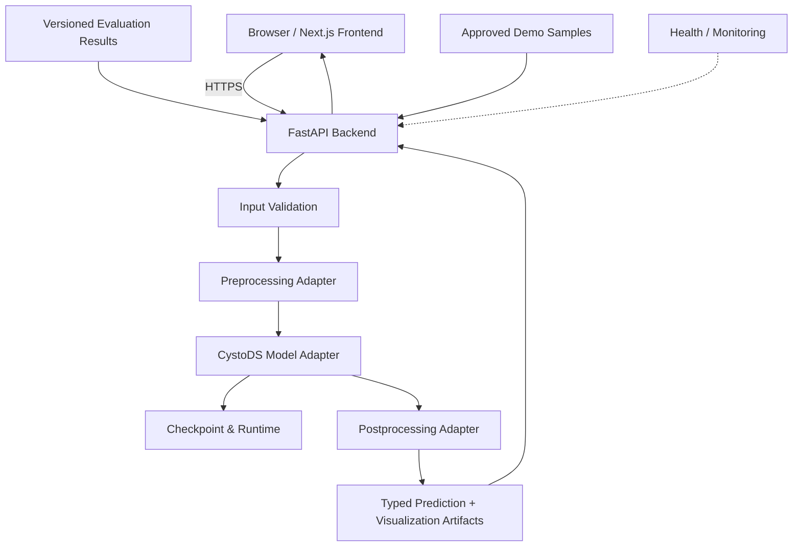

# CystoDS Research Platform — Kế hoạch triển khai website chi tiết

> **Loại tài liệu:** Product Requirements Document (PRD) + Technical Design + Delivery Plan  
> **Phiên bản:** 1.0 — Bản lập kế hoạch  
> **Ngày:** 05/11/2026  
> **Trạng thái:** Proposed / Chưa triển khai  
> **Đối tượng:** Chủ nhiệm nghiên cứu, kỹ sư ML, frontend/backend, người kiểm thử, người chuẩn bị thuyết trình KHKT

---

## 0. Tóm tắt điều hành

**Mục tiêu:** Xây dựng **CystoDS Research Platform**, một website công khai phục vụ giới thiệu nghiên cứu, minh họa quy trình và **demo inference bằng checkpoint thật**, đồng thời thể hiện bằng chứng thực nghiệm khoa học, phù hợp để trình diễn tại cuộc thi nghiên cứu khoa học kỹ thuật và chia sẻ với cộng đồng nghiên cứu.

**Nguyên tắc ưu tiên:**

1. **Model đúng trước, UI đẹp sau:** Kết quả inference phải khớp pipeline nghiên cứu đã kiểm chứng.
2. **Minh bạch:** Tách bạch live inference, kết quả dựng sẵn (precomputed) và các biểu đồ/metrics trích từ thí nghiệm offline.
3. **Không suy diễn lâm sàng:** Website là demo nghiên cứu, không mặc định là thiết bị chẩn đoán hoặc công cụ tư vấn y khoa.
4. **Triển khai vừa đủ:** Ra mắt MVP trước; không làm login, cơ sở dữ liệu lớn hoặc tính năng không phục vụ mục tiêu demo nếu chưa có nhu cầu.
5. **Có đường lui:** Đảm bảo demo trong môi trường thi có phương án chạy local và mẫu inference đã chuẩn bị.

### 0.1 Những điều đã biết và chưa được xác minh

| Nội dung | Mức độ chắc chắn | Cách xử lý |
|---|---|---|
| Tên dự án là **CystoDS** | Đã biết từ yêu cầu | Sử dụng nhất quán |
| Mục tiêu là website demo model, dùng cho nghiên cứu/KHKT | Đã biết từ trao đổi | Thiết kế cho người xem và hội đồng |
| Dự án có định hướng paper nghiên cứu | Đã biết từ trao đổi | Bổ sung phần Methodology/Evidence |
| CystoDS chính xác xử lý loại dữ liệu gì | **Chưa xác minh** | Không khóa loại dữ liệu trước khi audit model |
| Mô hình phân loại, phát hiện, phân đoạn hay đa nhiệm | **Chưa xác minh** | Xây result renderer theo `task_type` |
| Checkpoint, framework, input shape, preprocessing, threshold | **Chưa xác minh** | Bắt buộc audit ở Sprint 0 |
| Tên bệnh, cấu trúc giải phẫu, giá trị metric thực tế | **Chưa xác minh** | Không tự bịa, giữ placeholder được gắn nhãn |
| Điều kiện sử dụng hình ảnh/dữ liệu y tế | **Chưa xác minh** | Chỉ dùng dữ liệu có quyền và đã ẩn danh phù hợp |

> **Giả định thiết kế tạm thời:** CystoDS là model AI có thể demo bằng dữ liệu hình ảnh; nếu thực tế là dữ liệu tabular, tín hiệu hay văn bản, giữ lớp frontend/backend và điều chỉnh `InputAdapter` / `OutputRenderer`. Không mặc định CystoDS liên quan đến mắt, bàng quang hoặc bệnh lý cụ thể dựa trên tên gọi.

### 0.2 Definition of Success

- Người xem mở đường dẫn, hiểu bài toán nghiên cứu và chạy được **ít nhất một inference thực** mà không cần truy cập source code.
- Hội đồng nhìn thấy **đầu vào → xử lý → đầu ra → bằng chứng đánh giá** trong một luồng tối đa khoảng 3–5 phút.
- Mọi kết quả công bố truy ngược được tới model version, dataset/split và evaluation protocol.
- Có hệ thống kiểm thử và đường dẫn demo hoạt động ổn định trong điều kiện dự kiến.
- Không lưu hoặc làm lộ dữ liệu cá nhân nhạy cảm ngoài phạm vi được phép.

---

## 1. Mục tiêu, đối tượng và phạm vi

### 1.1 Mục tiêu sản phẩm

**G1. Live AI Demo:** Cho phép người dùng cung cấp mẫu input hợp lệ, chạy model thật và xem prediction.  
**G2. Research Storytelling:** Trình bày vấn đề, phương pháp, đóng góp, thực nghiệm và hạn chế.  
**G3. Scientific Reproducibility:** Cho thấy cấu hình version, cách đánh giá và nguồn các số liệu được công bố.  
**G4. Presentation Readiness:** Tối ưu cho thuyết trình ngắn; hỗ trợ local/offline fallback.  
**G5. Maintainability:** Thay checkpoint hoặc bổ sung output type không phải xây lại frontend.

### 1.2 Nhóm người dùng

| Persona | Mục đích | Hành động chính |
|---|---|---|
| Hội đồng KHKT | Hiểu tính mới và xác thực demo | Xem Overview, thử sample, xem baseline/ablation |
| Nhà nghiên cứu/giảng viên | Đánh giá phương pháp | Đọc Methodology, protocol, limitations, paper |
| Người xem phổ thông | Hiểu nghiên cứu trong vài phút | Xem video/ảnh ví dụ, thử sample |
| Nhóm phát triển | Kiểm thử và cập nhật model | Kiểm tra version, health, logs/metrics kỹ thuật |

### 1.3 Phạm vi chức năng

**P0 — Bắt buộc cho MVP**

- Landing page giới thiệu CystoDS và mục tiêu nghiên cứu.
- Live Demo: sample gallery, upload hợp lệ, inference, kết quả có trạng thái loading/error/success.
- API thực sự sử dụng checkpoint; preprocessing/postprocessing giống pipeline nghiên cứu.
- Model info/version; nhãn trạng thái live inference và precomputed.
- Các trang Research và Limitations dạng tĩnh nhưng truy nguyên được nguồn.
- Deploy HTTPS; kiểm tra file, chống abuse cơ bản; test E2E tối thiểu.

**P1 — Bản trình diễn KHKT**

- Before/After hoặc overlay comparison (nếu output hỗ trợ).
- Research Dashboard: baseline, ablation, metric definitions, dataset protocol.
- Failure-case gallery; mô tả tình huống model chưa tốt.
- Local/offline demo pack; rehearsal script và troubleshooting guide.
- Tùy chọn xuất báo cáo dự đoán được ghi rõ là phục vụ nghiên cứu.

**P2 — Bản mở rộng**

- So sánh nhiều model checkpoint có kiểm soát.
- Batch inference phục vụ nội bộ có quyền truy cập.
- Visualization nâng cao (attention/Grad-CAM) nếu có cơ sở kỹ thuật.
- Tải tài liệu nghiên cứu, open-source resources khi được cho phép.
- Monitoring và quản lý artifact nâng cao.

**Ngoài phạm vi MVP:** chẩn đoán lâm sàng, kê đơn, lưu hồ sơ bệnh nhân, quản lý tài khoản phức tạp, kho ảnh công khai không được phép, tự động huấn luyện lại trên file upload, chatbot trả lời như bác sĩ, dashboard với số liệu dựng hoặc benchmark không được xác minh.

---

## 2. Kiến trúc tổng thể

### 2.1 Sơ đồ hệ thống



### 2.2 Công nghệ mặc định

| Lớp | Đề xuất | Lý do | Điều kiện thay thế |
|---|---|---|---|
| Frontend | Next.js + TypeScript | SSR/SEO, routing, thành phần UI, triển khai tốt | Vite + React nếu không cần SSR |
| UI | Tailwind CSS + shadcn/ui | Giao diện đồng nhất, nhanh tùy biến | Component library khác nếu nhóm quen |
| Chart | Recharts | Dashboard chỉ số | ECharts nếu biểu đồ phức tạp |
| Visualization | Canvas/SVG | Mask, bounding box, image comparison | OpenSeadragon cho ảnh rất lớn |
| Backend | Python FastAPI | Gần hệ ML Python, OpenAPI/Pydantic | Flask nếu repo hiện có là Flask |
| Inference | Runtime gốc của model | Đảm bảo parity | ONNX nếu export/validation cho kết quả phù hợp |
| Artefact storage | Private object storage/file mount | Version checkpoint, phân quyền | Local filesystem cho demo nội bộ |
| Hosting frontend | Vercel hoặc container hosting | Deploy giao diện đơn giản | Hạ tầng trường/tổ chức |
| Backend hosting | VM/container CPU hoặc GPU theo nhu cầu | Tùy yêu cầu latency/VRAM | Local-only nếu demo offline |
| CI | GitHub Actions | Lint, test, build | Hệ CI khác tương đương |
| Observability | Structured logs + metrics | Theo dõi độ ổn định và lỗi | Không đưa thông tin ảnh nhạy cảm vào log |

> **Quyết định cần kiểm chứng:** Chỉ chọn GPU, ONNX, Redis/queue, database hoặc object storage sau khi benchmark model và xác định traffic; không thêm mặc định.

### 2.3 Các module backend

1. `InputValidator`: loại file, chữ ký file, dung lượng, dimensions, số trang/frame, quota.
2. `InputAdapter`: đọc ảnh/tín hiệu và tiền xử lý đúng phiên bản pipeline nghiên cứu.
3. `ModelRegistry`: nạp chính xác một checkpoint đã được xác minh; kiểm tra SHA-256 và config.
4. `InferenceService`: `eval()`/inference mode, quản lý device và giới hạn đồng thời.
5. `OutputAdapter`: ánh xạ logits/tensor sang định dạng domain, giữ metadata.
6. `VisualizationService`: tạo mask/boxes/overlays chỉ khi task hỗ trợ; không thay đổi prediction.
7. `MetricsRepository`: đọc kết quả offline versioned, không tính benchmark từ user uploads.
8. `SampleRepository`: đọc tập sample demo có giấy phép/phạm vi công bố rõ ràng.

### 2.4 Model Adapter Contract

```python
from typing import Protocol, Any

class ModelAdapter(Protocol):
    def load(self, checkpoint_path: str, config: dict) -> None: ...
    def validate_input(self, raw: bytes, media_type: str) -> dict: ...
    def preprocess(self, decoded_input: Any) -> Any: ...
    def predict(self, model_input: Any) -> Any: ...
    def postprocess(self, raw_output: Any, context: dict) -> dict: ...
    def metadata(self) -> dict: ...
```

**Yêu cầu:** cùng một bộ test reference phải cho kết quả parity tương đương khi chạy trực tiếp từ notebook/script gốc và chạy qua `ModelAdapter`.

---

## 3. Information Architecture (IA) và trang chức năng

### 3.1 Sitemap

```text
/
├── /demo
│   ├── [upload / samples / run prediction]
│   └── [results / visual comparison]
├── /research
│   ├── /methodology
│   ├── /experiments
│   └── /limitations
├── /results
├── /about
└── /privacy
```

Có thể tổ chức `/research` bằng tabs thay vì nhiều sub-route để tiết kiệm công sức P0. `/results` chỉ là trang tổng hợp số liệu nghiên cứu, **không** phải nơi lưu hồ sơ người dùng.

### 3.2 Homepage `/`

**Mục tiêu:** người xem hiểu dự án trong vòng 30–60 giây và biết cách mở demo.

**Section order:**

1. **Hero:** tên, tagline một câu, CTA `Try Live Demo`, `Explore Research`.
2. **Problem Statement:** bối cảnh thực tế, nhu cầu nghiên cứu, dẫn nguồn nếu có.
3. **Proposed Approach:** sơ đồ pipeline và đóng góp mô hình.
4. **Validated Highlights:** tối đa 3 chỉ số có evidence, ẩn nếu chưa kiểm chứng.
5. **Sample Gallery Preview:** chọn ví dụ đại diện với chú thích dữ liệu mẫu.
6. **Research Links:** paper, code, demo methodology (theo quyền công bố).
7. **Team/Contact:** thông tin được cho phép công khai.
8. **Footer:** Research-use disclaimer, Privacy, model version, license.

**Acceptance:** không có claim không nguồn; CTA dẫn đúng `/demo`; mobile usable; thời gian tải hợp lý.

### 3.3 Live Demo `/demo`

**Layout Desktop:** trái là input, phải là prediction; dưới là analysis panel.  
**Layout Mobile:** input → action → output → metadata; không ép hai cột khi màn hình hẹp.

**Input panel:**

- Upload `Browse` + drag/drop (chỉ những định dạng model hỗ trợ).
- 5–10 sample được phép sử dụng, có nhãn sample ID và nguồn.
- Preview với metadata tối thiểu, reset input, thông báo rõ giới hạn.
- Checkbox/notice nghiên cứu cho upload nhạy cảm nếu thực sự cần (không xem như thay thế cho sự cho phép sử dụng dữ liệu).

**Run panel:**

- Nút `Run Inference` chỉ bật khi input hợp lệ.
- Spinner + trạng thái `Queued / Running / Rendering` nếu backend hỗ trợ; MVP đồng bộ có loading chung.
- Hủy yêu cầu ở UI; với job chạy dài, cần backend cancellation thực nếu quảng cáo là hủy xử lý.
- Timeout rõ ràng và Retry có giới hạn.

**Output panel theo `task_type`:**

| Task | Thành phần cần hiển thị | Thành phần tùy chọn |
|---|---|---|
| Classification | Predicted class + score theo class + uncertainty caveat | Bar chart, threshold note |
| Detection | Bounding boxes + class + score | Zoom, toggle box, IoU demo khi có ground truth |
| Segmentation | Mask overlay + legend + original | Opacity slider, mask-only, area measures nếu hợp lệ |
| Multi-task | Tabs theo output và tổng hợp | So sánh giữa đầu ra |
| Khác | Renderer được implement rõ ràng | Không ép thành classification |

**Kết quả trả về:** request ID, model version, task type, prediction, inference time, trạng thái. Nếu sample có ground truth được công bố, hiện riêng nhãn **Reference Annotation**, không trộn với prediction.

**UX states:** `idle`, `invalid`, `ready`, `uploading`, `running`, `success`, `failed`, `timeout`, `rate-limited`, `unavailable`. Mỗi trạng thái có thông báo/kịch bản rõ ràng, không chỉ hiển thị spinner vô thời hạn.

### 3.4 Research `/research`

- Bài toán và giới hạn ứng dụng.
- Đầu vào/đầu ra chính thức.
- Kiến trúc tổng quan, các module; giải thích contribution so với baseline.
- Dataset và split policy: train/dev/test; nguồn dữ liệu, cỡ mẫu và hạn chế.
- Training protocol: optimizer, loss, augmentation, selection/checkpoint policy ở mức được phép công khai.
- Evaluation protocol: metric definitions, denominator, bootstrap/CI nếu phù hợp.
- Baseline và ablation: chỉ số lấy từ file versioned.
- Failure modes, bias, generalization, OOD và next research steps.

**Yêu cầu không được thiếu:** số liệu công bố phải đi cùng `dataset_version`, `split`, `evaluation_script_version`, `checkpoint_hash`, `evaluation_date` hoặc giải thích vì sao thiếu.

### 3.5 Results `/results`

Các khối có thể bật theo thực tế:

- Scorecards đúng metric của task.
- Confusion matrix (classification).
- PR/ROC curves (nếu có data và threshold protocol hợp lệ).
- Per-class/per-subgroup metrics và sample counts (khi có thể công bố).
- Baseline comparisons và error bars/confidence intervals.
- Ablation table.
- Failure case gallery có mô tả nguyên nhân giả thuyết, không khẳng định quá mức.

**Không làm:** biến 5–10 demo samples thành độ chính xác tổng quát; suy diễn từ heatmap sang “model đã hiểu nguyên nhân”; dùng figures thiếu provenance.

### 3.6 About & Privacy

- Ai xây dựng dự án; vai trò; tổ chức (nếu được phép).
- Tài liệu tham chiếu/giấy phép/paper.
- Research-only disclaimer.
- Privacy notice: loại dữ liệu được thu thập, dữ liệu lưu ở đâu, retention, contact, cách gửi yêu cầu xử lý dữ liệu.
- Disclosure rõ khi demo dùng nguồn third-party API hoặc công khai input (mặc định **không** công khai upload).

---

## 4. API Specification v1

### 4.1 Endpoint matrix

| Endpoint | Verb | Auth | Trả về | P |
|---|---|---|---|---|
| `/api/v1/health/live` | GET | Public | Trạng thái tiến trình | P0 |
| `/api/v1/health/ready` | GET | Internal/limited | Model loaded và sẵn sàng inference | P0 |
| `/api/v1/model/info` | GET | Public/sanitized | Model/version/input/task | P0 |
| `/api/v1/predict` | POST | Public + rate limit | Prediction thật | P0 |
| `/api/v1/samples` | GET | Public | Danh mục mẫu approved | P0 |
| `/api/v1/samples/{sample_id}` | GET | Public | Sample metadata + asset an toàn | P0 |
| `/api/v1/research/metrics` | GET | Public | Result manifest được phê duyệt | P1 |
| `/api/v1/research/experiments` | GET | Public | Baseline/ablation đã kiểm chứng | P1 |
| `/api/v1/admin/*` | tùy | Restricted | Tác vụ quản trị nội bộ nếu cần | P2 |

### 4.2 `POST /api/v1/predict`

**Request ban đầu:** `multipart/form-data` với `file` hoặc `sample_id` (chỉ một trong hai), kèm `visualization` tùy chọn. Giới hạn kích thước và mime phụ thuộc `model/info`.

**Ví dụ response — schema minh họa, không phải prediction CystoDS:**

```json
{
  "request_id": "demo-request-123",
  "status": "success",
  "model": {
    "name": "CystoDS",
    "version": "PLACEHOLDER_MODEL_VERSION",
    "checkpoint_sha256_prefix": "PLACEHOLDER_HASH"
  },
  "task_type": "segmentation",
  "result": {
    "predictions": [],
    "artifacts": []
  },
  "timing": {
    "preprocess_ms": null,
    "inference_ms": null,
    "postprocess_ms": null,
    "total_ms": null
  },
  "disclaimer": "Research demonstration only. Not for clinical diagnosis."
}
```

`task_type` ở trên là **ví dụ schema**; sẽ đổi sau audit. Nếu backend sinh file artifact, dùng URL tạm thời giới hạn truy cập và TTL hoặc trả dữ liệu nhỏ phù hợp; không dùng link public vĩnh viễn của user uploads.

**Error contract:**

```json
{
  "request_id": "demo-request-123",
  "status": "error",
  "error": {
    "code": "UNSUPPORTED_MEDIA_TYPE",
    "message": "Định dạng dữ liệu chưa được hỗ trợ.",
    "retryable": false
  }
}
```

**HTTP statuses:** 400 invalid request, 413 payload too large, 415 unsupported media, 422 invalid content, 429 rate-limited, 503 model unavailable, 504 timeout, 500 internal error. Không trả stacktrace hoặc filesystem path nội bộ ra client.

### 4.3 Versioning và contract

- Prefix `/api/v1`; breaking changes phải sang `/v2`.
- OpenAPI schema tự sinh; frontend types được generate hoặc duy trì contract tests.
- Trường bắt buộc trong mọi inference thành công: `request_id`, `status`, `model.version`, `task_type`, `result`.
- `model/info` là nguồn duy nhất cho input format, task type và khả năng visualization được hỗ trợ.
- Tránh hardcode class labels ở frontend; lấy từ metadata có version.

### 4.4 Định dạng result riêng theo task

```ts
// Ý tưởng thiết kế; cần điều chỉnh theo thực tế

type PredictionResult =
  | { type: 'classification'; classes: Array<{ id: string; label: string; score: number }> }
  | { type: 'detection'; boxes: Array<{ xyxy: [number, number, number, number]; label: string; score: number }> }
  | { type: 'segmentation'; masks: Array<{ classId: string; artifactId: string }> }
  | { type: 'custom'; schemaVersion: string; payload: unknown };
```

Coordinate system của boxes/masks phải ghi rõ: pixel trên **ảnh gốc**, ảnh đã resize hay normalized coordinates. Mask phải khớp dimensions khi overlay.

---

## 5. Data & Research Governance

### 5.1 Demo sample manifest

Mỗi mẫu phải có metadata:

```yaml
sample_id: SAMPLE_001
asset_path: approved_samples/SAMPLE_001.png
asset_sha256: PLACEHOLDER_SHA256
media_type: image/png
source: PLACEHOLDER_SOURCE
license_or_consent_basis: PLACEHOLDER_PERMISSION
anonymization_status: verified_or_not_applicable
intended_use: public_demo
ground_truth_available: false
notes: example_only
```

Quy tắc:

- Chỉ chọn mẫu đã được cấp quyền sử dụng/công bố.
- Không dùng ảnh có thông tin nhận dạng bệnh nhân, tên file định danh hay metadata nhạy cảm.
- Không bảo đảm mẫu là “chưa thấy” chỉ vì được chọn từ gallery; nếu mẫu là train/dev phải ghi rõ.
- Dùng sample đa dạng: trường hợp dễ, khó, sai hoặc không chắc chắn; không cherry-pick rồi tuyên bố accuracy.

### 5.2 Research metrics manifest

```json
{
  "result_set_id": "evaluation-v1",
  "dataset_version": "TO_BE_CONFIRMED",
  "split": "test",
  "sample_count": null,
  "checkpoint_sha256": "TO_BE_CONFIRMED",
  "evaluation_code_commit": "TO_BE_CONFIRMED",
  "metrics": {},
  "confidence_intervals": {},
  "created_at": null,
  "verified_by": null
}
```

**Release gate:** nếu metadata cần thiết còn trống, website nên ẩn ô metric hoặc hiển thị “Chưa công bố”, không tự điền giá trị giả.

### 5.3 Data retention / quyền riêng tư

- Mặc định xử lý ảnh trong RAM và loại bỏ sau response, nếu kỹ thuật cho phép.
- Nếu tạo file tạm: lưu ở thư mục tách biệt, giới hạn quyền, TTL ngắn, cleanup có test và theo dõi lỗi cleanup.
- Không log dữ liệu ảnh gốc, đường dẫn nhạy cảm, EXIF, thông tin định danh hoặc toàn bộ payload.
- Cho biết dữ liệu có rời khỏi máy/người dùng, đi qua nhà cung cấp cloud hoặc inference service nào.
- Chỉ công khai sample, result và dữ liệu nghiên cứu khi có đủ quyền.
- Đánh giá yêu cầu pháp lý/thể chế áp dụng trước khi nhận dữ liệu bệnh nhân thực tế; tài liệu này không thay thế tư vấn tuân thủ.

---

## 6. An toàn, bảo mật và độ tin cậy

### 6.1 Threat model tối thiểu

| Mối đe dọa | Biện pháp | Test |
|---|---|---|
| File upload độc hại | Allowlist, signature check, decode an toàn, size/dimension cap | Upload sai định dạng, file hỏng, decompression bomb |
| Flood requests / GPU exhaustion | Rate limit, concurrency limit, queue/busy response, timeout | Load test và burst test |
| Lộ thông tin người dùng | Không log payload, xóa temp, redaction | Review log & temp storage |
| CORS/CSRF/config lỏng | Origin allowlist, dùng token nếu cần, HTTPS | Security config tests |
| Dependency vulnerability | Lockfiles, audit dependencies, container scanning | CI security job |
| Model artifacts bị thay thế | Checksum/version pinning và private access | Checkpoint integrity test |
| Model crash/OOM | Bounded workers, resource limits, retry policy thận trọng | Soak test, batch/burst test |
| Kết quả giả mạo | Marker phân biệt live/precomputed, provenance metadata | UI evidence audit |
| Dữ liệu ngoài phân phối | Input validation, disclaimer, failure messaging | OOD sample tests |

### 6.2 Security acceptance gates

- Không có stacktrace hoặc secret trong response.
- Upload vượt giới hạn bị chặn **trước khi inference**.
- Tệp không hợp lệ không gây crash worker.
- Không có public directory listing cho input tạm.
- Rate limit và maximum concurrent inference được cấu hình và thử nghiệm.
- Có security headers hợp lý và HTTPS trên môi trường public.
- Không ghi ảnh gốc trong access/application logs.

### 6.3 Research disclaimer

Nội dung đề xuất:

> **Research demo only:** CystoDS là hệ thống trình diễn nghiên cứu. Kết quả dự đoán có thể sai, không thay thế đánh giá của chuyên gia hoặc quy trình chẩn đoán/chăm sóc y tế. Không tải lên dữ liệu cá nhân hoặc hình ảnh bệnh nhân nếu không có quyền và cơ sở sử dụng phù hợp.

Thể hiện tại footer, trang demo trước upload và trong phần báo cáo kết quả nếu cho phép xuất.

---

## 7. Model Verification & Evaluation

### 7.1 Model audit — Sprint 0 bắt buộc

Kiểm kê các tài sản:

- Repo và commit tham chiếu.
- Checkpoint, SHA-256, config và class mapping.
- Framework/runtime requirements (Python, CUDA/CPU, CUDA/cuDNN nếu cần).
- Input contract (shape, channel, dtype, normalization, format).
- Output contract (tensor shapes, class labels, thresholds, transformations).
- Pre/postprocessing chính xác.
- Bộ test reference gồm inputs và expected outputs từ script gốc.
- Kết quả latency trên máy mục tiêu.
- Kết quả evaluation/baseline/ablation có provenance.

### 7.2 Parity test bắt buộc

1. Chốt cùng checkpoint/config.
2. Lấy bộ ít nhất khoảng 20 input reference có thể dùng để test (quy mô điều chỉnh theo task).
3. Chạy notebook/script suy luận gốc và inference service mới trên cùng device/dtype khi có thể.
4. So sánh raw outputs trong tolerance phù hợp tính toán; sau đó so sánh predictions/masks/boxes sau postprocess.
5. Ghi threshold, rounding, interpolation và output coordinate semantics.
6. Chỉ mở public khi parity đạt acceptance gate do ML owner phê duyệt.

**Các lỗi hay gặp:** RGB/BGR đảo, resize khác nhau, normalization thiếu, sigmoid/softmax áp hai lần, khác threshold, mask interpolation sai, NMS không khớp, `train()` thay vì `eval()`, xử lý ảnh đầu vào xoay sai.

### 7.3 Metrics theo bài toán

| Bài toán | Chỉ số gợi ý | Ghi chú |
|---|---|---|
| Classification | AUROC, F1, sensitivity, specificity, precision, calibration | Cần định nghĩa positive class và threshold |
| Segmentation | Dice, IoU, per-class Dice, boundary errors | Ghi rõ xử lý empty masks |
| Detection | mAP, precision, recall, IoU criterion | Ghi rõ detection threshold và NMS |
| Multi-task | Metrics từng task và trade-offs | Không gộp số tùy tiện |

Báo cáo nên kèm cỡ mẫu, split, confidence intervals khi có thể, subgroup slices và failure cases. **Không dùng một vài lần demo live để ước lượng năng lực tổng quát.**

### 7.4 Benchmark latency

Đo trên chính phần cứng định deploy:

- Warm-up trước phép đo.
- Batch size = 1, đo ít nhất 50–100 lượt hợp lệ nếu tài nguyên cho phép.
- Tách preprocessing/inference/postprocessing/transfer/total.
- Báo cáo p50/p95, peak RAM/VRAM, kích thước checkpoint.
- Thử đồng thời 1, 2, 5 requests nếu hạ tầng hướng đến public.
- Ghi OS, CPU/GPU, runtime, checkpoint và sample shape.

**Target chỉ là mục tiêu thiết kế ban đầu, không phải kết quả đo:** 95% các request demo hợp lệ hoàn tất trong timeout được công bố; ngưỡng SLA cụ thể cần chốt từ benchmark.

---

## 8. UX/UI Design System

### 8.1 Tinh thần thiết kế

- Phong cách: scientific, clean, minimal, đáng tin cậy.
- Palette gợi ý: nền trắng/xám nhạt, navy/teal làm accent; dark mode có thể để P2.
- Chú trọng typography, spacing, trạng thái hệ thống và khả năng đọc số liệu.
- Không tạo hình ảnh mô phỏng kết quả AI khiến người xem nhầm với output thật.
- Biểu đồ nghiên cứu có nhãn trục, đơn vị, sample size và nguồn.

### 8.2 Component inventory

- `Navbar`, `Hero`, `ResearchSection`, `MetricCard`, `EvidenceBadge`.
- `UploadDropzone`, `SampleSelector`, `ImagePreview`.
- `RunButton`, `InferenceStatus`, `ErrorBanner`, `ModelVersionTag`.
- `PredictionPanel`, `ClassScoreChart`, `DetectionCanvas`, `SegmentationOverlay`, `OpacitySlider`.
- `ComparisonSlider`, `ConfusionMatrix`, `AblationTable`, `FailureCaseCard`.
- `ResearchDisclaimer`, `PrivacyNotice`, `Footer`.

`EvidenceBadge` dùng nhãn trung tính như `Verified offline`, `Demo sample`, `Precomputed`, `Experimental` — không hiển thị khoa trương hoặc gắn badge không có chứng cứ.

### 8.3 Responsive & Accessibility

- Mobile-first; breakpoint tham chiếu 360px, 768px, 1024px, 1440px.
- Keyboard accessibility cho upload, tabs, sliders.
- Visible focus, contrast phù hợp, alt text cho imagery.
- Không dùng màu đơn độc để phân biệt các nhóm dự đoán.
- Biểu đồ có mô tả văn bản thay thế.
- Thông báo tiến độ/lỗi qua vùng ARIA live nếu phù hợp.
- Ảnh phóng to không vượt viewport, overlay giữ căn chỉnh sau resize.

### 8.4 Wireframe mô tả

```text
┌────────────────────────── CYSTODS NAVBAR ──────────────────────────┐
│ LOGO          Demo   Research   Results   About        Try Demo     │
├───────────────────────────────────────────────────────────────────┤
│                                                                    │
│  INPUT PANEL                        OUTPUT PANEL                   │
│  ┌──────────────────────────┐       ┌───────────────────────────┐   │
│  │ Select sample / Upload   │       │ Original / Prediction     │   │
│  │ Preview + validation     │       │ Overlay / Boxes / Scores  │   │
│  └──────────────────────────┘       └───────────────────────────┘   │
│                                                                    │
│   [ RUN INFERENCE ]                                                │
├───────────────────────────────────────────────────────────────────┤
│ Analysis: task-specific details | model version | processing time  │
├───────────────────────────────────────────────────────────────────┤
│ Research-use disclaimer | privacy note                             │
└───────────────────────────────────────────────────────────────────┘
```

---

## 9. Repository & Developer Workflow

### 9.1 Monorepo đề xuất

```text
cystods-platform/
├── frontend/
│   ├── app/
│   │   ├── page.tsx
│   │   ├── demo/page.tsx
│   │   ├── research/page.tsx
│   │   ├── results/page.tsx
│   │   ├── about/page.tsx
│   │   └── privacy/page.tsx
│   ├── components/
│   │   ├── common/
│   │   ├── upload/
│   │   ├── predictions/
│   │   ├── visualization/
│   │   └── research/
│   ├── lib/api/
│   ├── types/
│   ├── public/approved/
│   └── tests/
├── backend/
│   ├── app/
│   │   ├── main.py
│   │   ├── api/v1/
│   │   ├── schemas/
│   │   ├── services/
│   │   ├── adapters/
│   │   ├── security/
│   │   └── config.py
│   ├── tests/
│   │   ├── unit/
│   │   ├── integration/
│   │   └── parity/
│   └── pyproject.toml
├── model/
│   ├── manifest.example.yaml
│   └── README.md
├── research/
│   ├── metrics_manifest.json
│   ├── experiments_manifest.json
│   └── approved_samples_manifest.yaml
├── infra/
│   ├── Dockerfile.frontend
│   ├── Dockerfile.backend
│   └── docker-compose.yml
├── docs/
│   ├── API.md
│   ├── MODEL_INTEGRATION.md
│   ├── SECURITY_PRIVACY.md
│   ├── EVALUATION_PROVENANCE.md
│   ├── DEMO_SCRIPT.md
│   └── RUNBOOK.md
├── .github/workflows/ci.yml
├── .env.example
└── README.md
```

### 9.2 Git workflow

- Main branch protected; thay đổi qua PR.
- Mỗi PR có scope nhỏ, linked issue, test evidence và ảnh UI nếu cần.
- Quy ước issue ID: `FE-xx`, `BE-xx`, `ML-xx`, `QA-xx`, `OPS-xx`, `DOC-xx`.
- Lưu `requirements`/lockfile; pin model artifact bằng hash.
- Không commit checkpoint nặng, credential, patient data hoặc input upload.

### 9.3 Quality gates trên CI

Frontend: typecheck, ESLint, unit/UI tests, build.  
Backend: Ruff/format, Pytest unit, schema tests, security checks.  
Integration: API contract tests và E2E trên môi trường staging.  
Model parity: test reference riêng; có thể yêu cầu runner có GPU; nếu không chạy phải ghi `PENDING`, không báo `PASS`.

---

## 10. Backlog dạng ticket (có phụ thuộc)

**Ước lượng:** `S` = 0,5–1 ngày, `M` = 1–2 ngày, `L` = 2–4 ngày; chỉ để lập kế hoạch, tùy trạng thái repo và người triển khai.

| ID | P | Deliverable / Ticket | Phụ thuộc | Size | Acceptance Criteria |
|---|---|---|---|---|---|
| ML-01 | P0 | Audit checkpoint & model I/O | Repo/checkpoint | M | Manifest đủ input/output/version |
| ML-02 | P0 | Reference inference script | ML-01 | M | Bộ mẫu gốc và outputs có hash |
| BE-01 | P0 | FastAPI skeleton + OpenAPI | — | S | `/health` và API docs chạy |
| BE-02 | P0 | Validation & upload security | BE-01, ML-01 | M | Chặn file sai, oversized, corrupt |
| BE-03 | P0 | ModelAdapter + inference service | ML-01, BE-01 | L | Chạy prediction thật với checkpoint |
| QA-01 | P0 | Model parity suite | ML-02, BE-03 | M | So sánh được reference và API |
| BE-04 | P0 | Prediction response schema | BE-03 | S | Type/task/version nhất quán |
| FE-01 | P0 | Design system + app shell | — | M | Navbar, footer, responsive |
| FE-02 | P0 | Homepage | FE-01 | M | CTA, section và disclosure đầy đủ |
| FE-03 | P0 | Upload/sample selector | FE-01, BE-02 | M | Input state và validation rõ |
| FE-04 | P0 | Prediction viewer | BE-04, FE-01 | L | Render đúng `task_type` đã kiểm chứng |
| FE-05 | P0 | Inference flow + error handling | FE-03, FE-04 | M | Success/fail/timeout/429 có UI |
| DOC-01 | P0 | Research content & disclaimer | ML-01 | M | Không có số liệu/claim không nguồn |
| OPS-01 | P0 | Docker, staging + env setup | BE-03, FE-02 | M | Chạy được staging từ README |
| QA-02 | P0 | Smoke + E2E tests | FE-05, OPS-01 | M | End-to-end demo happy & fail paths |
| RES-01 | P1 | Benchmark manifest & renderer | ML results | M | Metric có provenance và đúng split |
| RES-02 | P1 | Baseline & ablation tables | RES-01 | M | So sánh có protocol/caveat |
| FE-06 | P1 | Overlay / comparison viewer | FE-04 | M | Không lệch tọa độ ảnh |
| RES-03 | P1 | Failure case gallery | Approved samples | M | Có cả failure, không cherry-pick |
| OPS-02 | P1 | Latency/load benchmark | OPS-01 | M | p50/p95, RAM/VRAM, concurrency log |
| OPS-03 | P1 | Offline/local demo kit | BE-03, FE-05 | M | Chạy và phục hồi sau mất mạng |
| DOC-02 | P1 | Presenter script + runbook | FE-05, RES-01 | S | Kịch bản 3–5 phút đã tập thử |
| QA-03 | P1 | Accessibility & usability review | FE-05 | M | Keyboard/mobility/viewport QA |
| FE-07 | P2 | Export research report | FE-04 | M | Metadata và disclaimer đầy đủ |
| BE-05 | P2 | Async job queue | Benchmark cần | L | Cancel/retry/resource controls thật |
| OPS-04 | P2 | Advanced monitoring | Ops needs | M | Không thu PII, dashboard hữu ích |

### 10.1 Critical path

`ML-01 → ML-02 → BE-03 → QA-01 → BE-04 → FE-04 → FE-05 → QA-02 → Release`

Có thể phát triển `FE-01`, `FE-02`, `BE-01` song song, nhưng **không chốt UI prediction renderer hoặc claim hiệu năng trước audit model**.

---

## 11. Roadmap 4 tuần + Sprint 0

> **Tiền đề:** checkpoint, repo và ít nhất một người ML biết vận hành model sẵn có. Nếu checkpoint chưa chạy được hoặc chưa có quyền sử dụng dữ liệu, phải mở rộng Sprint 0; không coi kế hoạch 4 tuần là cam kết.

### Sprint 0 — Discovery & Feasibility (1–3 ngày trước tuần 1)

**Công việc:**

- Thu thập repo/commit, checkpoint/config, data contract, results và giấy phép mẫu demo.
- Chạy một inference gốc, chụp log môi trường chạy, pin dependencies.
- Kiểm tra tài nguyên phần cứng, thời gian inference, dữ liệu upload và bảo mật.
- Chốt output type, class names, demo samples, mức công khai research artifacts.
- Ký duyệt `Model Integration Specification v1`.

**Exit gate:** ML owner xác nhận input/output và checkpoint có thể chạy; nếu chưa, dừng tích hợp UI với model giả định.

### Tuần 1 — Model Integration & API

**Ngày 1–2:** audit lại pipeline, model manifest, reference samples.  
**Ngày 3–4:** FastAPI, validation, adapter, response schema.  
**Ngày 5:** parity test, review lỗi shape/threshold, đóng API contract.

**Bàn giao:** backend local, OpenAPI, model info, prediction thật, parity report.

### Tuần 2 — Frontend & Demo MVP

**Ngày 1:** design tokens, nav/footer, homepage.  
**Ngày 2:** upload/sample gallery và state machine.  
**Ngày 3:** prediction viewer theo task type.  
**Ngày 4:** tích hợp API, trạng thái lỗi/loading.  
**Ngày 5:** responsive + smoke/E2E tests.

**Bàn giao:** demo end-to-end, bản xem trên desktop và mobile.

### Tuần 3 — Research & Presentation

**Ngày 1:** research content, methodology, architecture visualization.  
**Ngày 2:** metrics manifest, scorecards/graphs.  
**Ngày 3:** baseline/ablation/failure cases với provenance.  
**Ngày 4:** overlay/comparison tương thích output.  
**Ngày 5:** review khoa học, UX và claims.

**Bàn giao:** Research dashboard có bằng chứng, sample gallery phong phú, bản demo cho hội đồng.

### Tuần 4 — Hardening & Deployment

**Ngày 1:** full testing, file upload attack cases.  
**Ngày 2:** benchmark latency/load/resource, limit inference concurrency.  
**Ngày 3:** staging/production deploy, domain, HTTPS, health monitoring.  
**Ngày 4:** local demo package, recovery playbook.  
**Ngày 5:** rehearsal, bug fixes, freeze release, kiểm tra artifact.

**Bàn giao:** public demo link, release tag, runbook, test evidence, fallback.

### 11.1 Tỷ lệ công sức khuyến nghị

- **60%:** AI inference, độ đúng, tích hợp, robustness.
- **25%:** nghiên cứu, kết quả, minh bạch khoa học.
- **15%:** presentation/UI polish.

Đây là ưu tiên, không phải phân bổ cố định của mọi nhóm.

---

## 12. Test Plan chi tiết

### 12.1 Test pyramid

| Lớp | Test | Owner |
|---|---|---|
| Unit | Validator, pre/postprocess utils, type mapping | BE/ML |
| ML parity | Script gốc vs API, numerical/output tolerance | ML |
| API integration | Upload → predict, error codes, model version | BE |
| Frontend component | Upload states, viewers, overlays | FE |
| E2E | Sample → run → result, upload lỗi, retry | QA/FE |
| Non-functional | Responsive, accessibility, load, OOM | QA/OPS |
| Scientific review | Metrics provenance, labels, claims và disclaimers | Research owner |

### 12.2 Cases tối thiểu

**Input:** supported image; unsupported type; extension spoofing; corrupt image; oversized file; zero-byte file; aspect ratio bất thường; resolution quá lớn; missing file; sample ID không hợp lệ.  
**Inference:** model unavailable; checkpoint integrity mismatch; invalid tensor; timeout; two simultaneous requests; device OOM; unexpected output shape.  
**Visualization:** overlay đúng pixel/coordinate; labels đúng; xử lý null/empty predictions; mobile resize; canvas zoom/opacity.  
**Science:** model version đúng; metrics không lấy từ live samples; baseline có source; screenshot ghi live/precomputed rõ.  
**Security:** không log nội dung input, path traversal, temporary retention cleanup, secrets scanning.  
**Accessibility:** keyboard-only, focus visibility, alt text, color independence, zoom 200%.

### 12.3 Release gates (tất cả phải được kiểm tra)

- [ ] **GATE-ML:** Checkpoint integrity đã xác minh.
- [ ] **GATE-ML:** Reference parity test đạt; tolerance được tài liệu hóa.
- [ ] **GATE-API:** API schema ổn định; error contract hoạt động.
- [ ] **GATE-UX:** Live Demo end-to-end pass trên desktop/mobile mục tiêu.
- [ ] **GATE-SEC:** File restrictions, rate limits, no sensitive logs.
- [ ] **GATE-SCI:** Metrics/claims có nguồn; còn thiếu thì không hiển thị.
- [ ] **GATE-OPS:** Hosting, HTTPS, health check, rollback và fallback được thử.
- [ ] **GATE-DEMO:** Rehearsal và demo script được duyệt.

Bất kỳ gate nào còn `PENDING` hoặc `FAIL` phải được ghi nhận đúng và quyết định release có trách nhiệm, không tự mặc định đã đạt.

---

## 13. Deployment, vận hành và khả năng phục hồi

### 13.1 Môi trường

- **Local dev:** backend local CPU/GPU; frontend local; mock API **chỉ** dùng cho phát triển frontend, có nhãn dev rõ.
- **Staging:** environment gần production, sample data đã approved.
- **Production:** frontend CDN/host, inference backend riêng, secret manager, HTTPS.
- **Offline venue:** cùng code model hoặc Docker image/local launcher, các sample/cache cần thiết.

### 13.2 Production checklist

- [ ] `APP_ENV`, `ALLOWED_ORIGINS`, `MODEL_PATH`, `MODEL_HASH`, `DEVICE`, `MAX_UPLOAD_BYTES`, `MAX_CONCURRENT_INFERENCE`, `REQUEST_TIMEOUT_SECONDS` cấu hình qua environment.
- [ ] Có giới hạn memory/CPU/GPU, worker count hợp lý.
- [ ] Checkpoint được cache/nạp một lần theo vòng đời service; readiness chỉ pass khi model sẵn sàng.
- [ ] Không để inference endpoint chấp nhận file hoặc URL từ internet tùy ý nếu chưa có kiểm soát SSRF.
- [ ] Thống kê response status, latency, error rate và resource usage, **không chứa ảnh**.
- [ ] Có version/commit trong release metadata.
- [ ] Rollback đến version trước bằng image tag + checkpoint manifest bất biến.

### 13.3 Sự cố và cách xử lý

| Sự cố | Dấu hiệu | Hành động |
|---|---|---|
| GPU OOM | Request 500/worker restart | Giới hạn concurrency, kiểm tra memory, rollback |
| Model load fail | Readiness fail | Kiểm tra hash/driver/config, không đưa traffic vào |
| Inference chậm | p95 tăng | Kiểm tra sample size, queue, CPU/GPU utilization |
| Upload abuse | 429/413 tăng | Điều chỉnh limit, chặn nguồn tấn công hợp lệ |
| Hosting downtime | Website không truy cập | Chuyển local demo; dùng precomputed có nhãn |
| Dữ liệu nhạy cảm xuất hiện | Log/temp/asset không phù hợp | Dừng route liên quan, xóa theo chính sách, rà soát và xử lý sự cố |

### 13.4 Demo trực tiếp vs precomputed

- **Live mode:** luôn hiển thị trạng thái inference và model version thật.
- **Precomputed mode:** phải ghi nhãn `Precomputed Example` cạnh output.
- **Offline mode:** nếu chạy inference local thật, ghi `Local Live Inference` và có version.
- **Không được:** dùng output dựng sẵn mà nói là hệ thống vừa suy luận từ file mới tải lên.

---

## 14. Dự trù nguồn lực & chi phí

### 14.1 Nhân lực tối thiểu

| Vai trò | Nhiệm vụ | Có thể kiêm nhiệm? |
|---|---|---|
| ML Engineer / Model Owner | Audit, adapter, parity, optimization | Có |
| Full-stack Engineer | Frontend + API + deployment | Có |
| Research Owner | Paper content, metrics, limitations, evidence | Có |
| QA / Presenter | Test, rehearsal, UX, demo scripts | Có |

**Nhóm 1 người:** nên tập trung P0; thời gian 4 tuần có thể không thực tế nếu phải vừa train model vừa xây web.  
**Nhóm 2 người:** ML/backend và frontend có thể chạy song song.  
**Nhóm 3–4 người:** thêm research/evaluation, QA và vận hành.

### 14.2 Nhóm chi phí cần ước lượng sau benchmark

1. Domain + frontend hosting.
2. CPU/GPU inference server theo giờ hoạt động và số request.
3. Bandwidth/egress và lưu trữ artifact approved.
4. Monitoring/log retention (không chứa PII).
5. Quỹ dự phòng cho demo local, vật tư và kết nối mạng.

**Không chốt con số tiền khi chưa biết** model size, peak VRAM, inference p95, số người dùng đồng thời và khả năng scale-to-zero.

### 14.3 Lựa chọn theo mức sẵn sàng

| Phương án | Khi nào phù hợp | Trade-off |
|---|---|---|
| Gradio prototype | Chưa chốt I/O, cần model chạy sớm | Ít tự do thiết kế |
| Next.js + FastAPI CPU | Model nhẹ, public traffic thấp | Có thể chậm |
| Next.js + FastAPI GPU | Model lớn, yêu cầu thời gian phản hồi thấp | Chi phí và ops cao hơn |
| Website + offline local | Thi KHKT tại địa điểm hạn chế internet | Phụ thuộc máy mang theo |

---

## 15. Risk Register

| ID | Rủi ro | Xác suất | Ảnh hưởng | Giảm thiểu | Chủ sở hữu |
|---|---|---|---|---|---|
| R01 | Model chưa chạy được ngoài notebook | Cao khi chưa audit | Rất cao | Sprint 0, manifest, Docker | ML |
| R02 | Sai preprocessing/threshold | Trung bình | Rất cao | Parity suite và reference outputs | ML |
| R03 | VRAM không đủ hoặc latency cao | Chưa biết | Cao | Benchmark, concurrency cap, local fallback | ML/OPS |
| R04 | Quyền công bố dữ liệu chưa rõ | Chưa biết | Rất cao | Approved samples only, privacy review | Research |
| R05 | Dữ liệu test/benchmark thiếu nguồn | Trung bình | Cao | Metrics manifest và claim audit | Research |
| R06 | Hội đồng không có internet | Trung bình | Cao | Local demo + precomputed minh bạch | OPS |
| R07 | UI hiển thị sai mask/box | Trung bình | Cao | Pixel alignment tests | FE/QA |
| R08 | File upload bị abuse | Trung bình | Cao | Rate limit, validator, bounded resources | BE/OPS |
| R09 | Scope creep | Cao | Trung bình | P0/P1/P2 và release gates | Lead |
| R10 | Website bị hiểu nhầm là chẩn đoán | Trung bình | Rất cao | Disclaimers, copy review, không clinical claims | Research |

**Risk review cadence:** cập nhật ít nhất mỗi tuần, và ngay khi có blocker ở critical path.

---

## 16. Kịch bản trình diễn KHKT (3–5 phút)

| Thời lượng dự kiến | Hoạt động | Mục đích | Dự phòng |
|---|---|---|---|
| 0:00–0:30 | Hero + Problem | Định vị vấn đề | Slide ảnh chụp homepage |
| 0:30–1:00 | Architecture diagram | Nêu ý tưởng kỹ thuật | Sơ đồ tĩnh |
| 1:00–2:30 | Chọn sample hoặc upload và chạy live | Chứng minh model chạy thực | Local inference hoặc precomputed có nhãn |
| 2:30–3:20 | So sánh prediction với input | Giải thích output | Ảnh kết quả đã duyệt |
| 3:20–4:20 | Research Dashboard: baseline/ablation | Chứng minh bằng chứng | Bảng số liệu có nguồn |
| 4:20–5:00 | Limitations + future work | Thể hiện tư duy nghiên cứu | Slide kết luận |

**Kịch bản câu hỏi phản biện cần chuẩn bị:**

- Điểm mới của CystoDS so với baseline là gì?
- Sample này có thuộc train set không?
- Bằng chứng nào cho biết model hoạt động tốt ngoài những ảnh demo?
- Nếu dữ liệu đầu vào khác phân phối huấn luyện, model phản ứng thế nào?
- Đây có phải công cụ chẩn đoán không?
- Kết quả có tái lập được từ checkpoint, config và evaluation script không?

**Quy tắc biểu diễn:** không hứa quá mức; một demo chạy thành công không thay thế đánh giá trên test set độc lập.

---

## 17. Artefacts cần bàn giao

### 17.1 Kỹ thuật

- [ ] Git repository có README hướng dẫn cài và chạy.
- [ ] Frontend hoàn chỉnh trên staging/production.
- [ ] FastAPI service với OpenAPI/schema.
- [ ] ModelAdapter + model manifest/checkpoint integrity.
- [ ] Reference parity tests và evidence report.
- [ ] Dockerfiles, docker-compose hoặc deployment manifests.
- [ ] CI pipeline và test logs.
- [ ] `.env.example` không chứa secrets.
- [ ] Monitoring/runbook/rollback procedure.

### 17.2 Nghiên cứu

- [ ] Architecture diagram.
- [ ] Dataset/evaluation protocol.
- [ ] Versioned metrics manifest.
- [ ] Baseline và ablation evidence.
- [ ] Approved sample set với provenance.
- [ ] Limitations / ethical use / privacy note.

### 17.3 Trình bày

- [ ] Public demo URL hoạt động.
- [ ] Local/offline demo kit.
- [ ] Script trình diễn 3–5 phút.
- [ ] Bộ câu hỏi phản biện và câu trả lời.
- [ ] Screenshots/video backup được ghi rõ là backup.
- [ ] Release notes: version, known issues, giới hạn.

---

## 18. Decision Log — cần xác nhận trước khi thực thi

| ID | Quyết định | Người chốt | Hạn chót gợi ý | Trạng thái |
|---|---|---|---|---|
| D01 | CystoDS nhận input gì? | ML owner | Sprint 0 | OPEN |
| D02 | Output task type và label schema? | ML owner | Sprint 0 | OPEN |
| D03 | Checkpoint production/version/hash? | ML owner | Sprint 0 | OPEN |
| D04 | Image preprocessing/postprocessing chuẩn? | ML owner | Sprint 0 | OPEN |
| D05 | Bộ demo sample nào được công bố? | Research owner | Tuần 1 | OPEN |
| D06 | Metrics/baseline/ablation nào có bằng chứng? | Research owner | Tuần 2 | OPEN |
| D07 | CPU/GPU hosting nào đủ latency? | ML/OPS | Tuần 1–4 | OPEN |
| D08 | Có cần user upload hay chỉ approved samples? | Product/Research | Sprint 0 | OPEN |
| D09 | Public domain và quyền sở hữu source/model? | Product owner | Tuần 3 | OPEN |
| D10 | Điều kiện dữ liệu, disclaimer, retention? | Product/Research | Tuần 1 | OPEN |

### 18.1 Mẫu Model Integration Specification để điền

```yaml
project: CystoDS
repository_url: TO_BE_CONFIRMED
repository_commit: TO_BE_CONFIRMED
checkpoint_uri: TO_BE_CONFIRMED
checkpoint_sha256: TO_BE_CONFIRMED
framework: TO_BE_CONFIRMED
python_version: TO_BE_CONFIRMED
runtime_device: TO_BE_CONFIRMED
input:
  modality: TO_BE_CONFIRMED
  formats: []
  shape: TO_BE_CONFIRMED
  dtype: TO_BE_CONFIRMED
  preprocessing: TO_BE_CONFIRMED
output:
  task_type: TO_BE_CONFIRMED
  labels: []
  postprocessing: TO_BE_CONFIRMED
  visualization_capabilities: []
evaluation:
  dataset_version: TO_BE_CONFIRMED
  test_split: TO_BE_CONFIRMED
  evaluation_commit: TO_BE_CONFIRMED
  results_manifest: TO_BE_CONFIRMED
serving:
  batch_size: 1
  benchmark_hardware: TO_BE_CONFIRMED
  measured_p50_ms: null
  measured_p95_ms: null
  peak_memory_mb: null
security:
  publicly_uploadable: TO_BE_CONFIRMED
  retention_policy: TO_BE_CONFIRMED
```

---

## 19. Công việc phải bắt đầu đầu tiên

**Thứ tự khuyến nghị trong 1–3 ngày đầu:**

1. Mở repo CystoDS và xác định script inference đang hoạt động.
2. Chốt một checkpoint chính xác (hash) và 5–20 mẫu test reference được phép dùng.
3. Đo đầu vào/đầu ra bằng script gốc, lưu expected outputs.
4. Viết Model Integration Specification ở trên.
5. Khởi tạo FastAPI và expose endpoint `/api/v1/model/info` + `/api/v1/predict`.
6. Sau khi có inference parity pass mới tiến tới prediction viewer.

**Tiêu chí kết thúc giai đoạn đầu:** Không cần homepage đẹp, nhưng phải có ít nhất một request hợp lệ trả về **kết quả model thật, đúng checkpoint, đúng pipeline và có thể kiểm thử lại**.

---

## 20. Checklist nghiệm thu tổng hợp

### Sản phẩm
- [ ] Website có landing page, demo, research, limitations và privacy.
- [ ] Luồng thử model chạy từ đầu tới cuối.
- [ ] Demo có lỗi đầu vào và lỗi server được xử lý.
- [ ] Giao diện responsive và có hỗ trợ cơ bản cho accessibility.

### Khoa học
- [ ] Không sử dụng số liệu tự bịa hoặc không truy nguồn.
- [ ] Inference parity được xác nhận bằng test.
- [ ] Dataset split và checkpoint version được mô tả rõ.
- [ ] Có failure cases và giới hạn sử dụng.

### Vận hành
- [ ] Chạy được trên môi trường hosting đã chọn.
- [ ] Rate limit, timeout, input validation được kiểm tra.
- [ ] Có healthcheck, logs an toàn, rollback và offline fallback.
- [ ] Team đã diễn tập trình bày thực tế.

---

## Phụ lục A — Quy ước Definition of Done cho mọi ticket

Một ticket chỉ được `DONE` khi:

1. Tính năng được implement trên nhánh/PR tương ứng.
2. Có test phù hợp, không phá vỡ test hiện tại.
3. Nếu có API, schema hoặc contract được cập nhật.
4. Nếu có chỉ số/model output, nguồn và version được chỉ rõ.
5. Có bằng chứng chạy thực tế (`PASS`, `FAIL`, hoặc `PENDING` rõ ràng).
6. Được review phù hợp, không để lộ secret và dữ liệu nhạy cảm.

## Phụ lục B — Khuôn mẫu báo cáo cuối sprint

```text
SPRINT:
STATUS: PASS / PARTIAL / BLOCKED
DELIVERABLES:
FILES / PRS:
TESTS RUN (COMMANDS + ENV):
MODEL VERSION / CHECKPOINT:
EVIDENCE:
KNOWN ISSUES:
RISKS:
NEXT ACTIONS / OWNERS:
```

## Phụ lục C — Chính sách về minh bạch demo

- **Live Inference:** Prediction phát sinh từ request hiện tại, dùng checkpoint đã công bố version.
- **Local Live Inference:** Tương tự, nhưng chạy trên máy trình diễn.
- **Precomputed:** Prediction tính trước, phải ghi nhãn rõ.
- **Illustrative UI:** Mockup chỉ minh họa thiết kế; không trình bày như số liệu hoặc model output thật.
- **Offline Benchmark:** Kết quả đo từ dataset/evaluation protocol, không phải từ phiên demo.
- **Unknown / Not verified:** Ẩn metric hoặc ghi tình trạng chưa xác minh.

---

**Tình trạng tài liệu:** Kế hoạch đã sẵn sàng để chia việc và chuyển thành GitHub Issues. Những thông số liên quan model và thí nghiệm vẫn `OPEN` cho tới khi có repository/checkpoint/dữ liệu thực tế; không xem đây là bằng chứng model đã được tích hợp, thử nghiệm hoặc triển khai.
